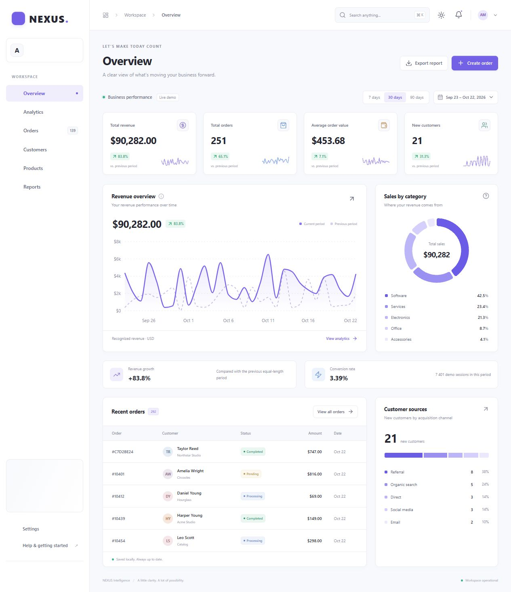
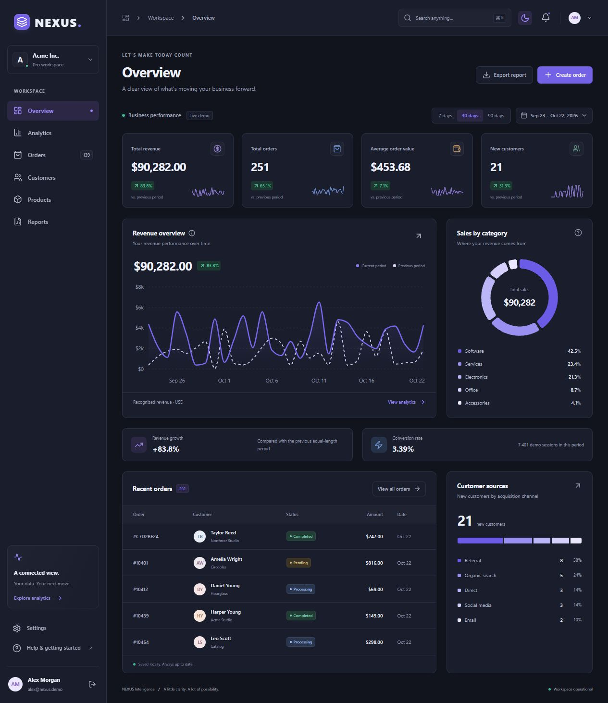
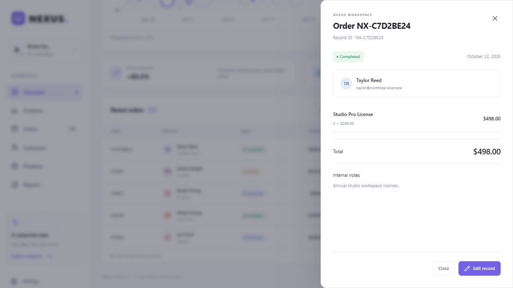
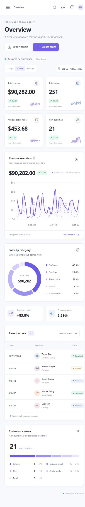

# NEXUS — Business Intelligence

Многостраничная SaaS-платформа бизнес-аналитики для frontend-портфолио. Полноценные сценарии управления заказами, клиентами и каталогом: сохраняемые изменения, связанные данные, единые расчёты аналитики и экспорт.

> Это самостоятельная браузерная демоверсия. Асинхронный mock API работает поверх IndexedDB, а демонстрационный вход не обеспечивает реальную безопасность.

[Открыть NEXUS](https://dmitrysd208111.github.io/nexus/) · [Исходники на GitHub](https://github.com/Dmitrysd208111/nexus) · [Проверки и деплой](https://github.com/Dmitrysd208111/nexus/actions)

## Скриншоты

Реальные снимки работающего приложения; цифры зависят от даты первого запуска и внесённых изменений.

### Overview · светлая тема



### Overview · тёмная тема



### Просмотр заказа



### Мобильный интерфейс



## Стек

| Область             | Технологии                                                                  |
| ------------------- | --------------------------------------------------------------------------- |
| Основа              | React 19, TypeScript strict, Vite                                           |
| Интерфейс           | Tailwind CSS 4, CSS variables, Lucide React                                 |
| Маршрутизация       | React Router, ленивые модули страниц                                        |
| Запросы             | TanStack Query, инвалидация зависимых данных после мутаций                  |
| Таблицы             | TanStack Table: фильтрация, сортировка, пагинация, выбор строк              |
| Локальное состояние | Zustand; сохранение настроек через persist                                  |
| Формы               | React Hook Form, Zod, динамические позиции заказа                           |
| Визуализация        | Recharts, date-fns                                                          |
| Сохранение          | IndexedDB через idb, атомарные read/write-транзакции                        |
| Качество            | Vitest, React Testing Library, user-event, fake-indexeddb, ESLint, Prettier |

## Запуск

Нужен Node.js **22.12+** (или 24+) и npm. Секреты, аккаунты и внешний API не нужны.

```bash
npm ci
npm run dev
```

Откройте Local URL, напечатанный Vite. Обычно это `http://127.0.0.1:5173`; если порт занят, Vite выберет следующий.

```bash
npm run typecheck
npm run lint
npm test
npm run build
npm run preview
```

Дополнительно: `npm run test:watch`, `npm run format`, `npm run format:check`.

## Демо-доступ

Первое посещение открывает Overview с активной демонстрационной сессией. Кнопка выхода в sidebar или меню профиля переводит на `/login`.

- Email: `alex@nexus.demo`
- Пароль: `demo1234`
- Для исследования принимаются любой корректный email и пароль длиной от четырёх символов.
- Пароль не сохраняется. В localStorage хранится только флаг демосессии и пользовательские настройки.

## Возможности

- **Overview**: четыре основные KPI-карточки, Revenue Growth и Conversion Rate, выручка по датам с сравнением, продажи по категориям, недавние заказы, источники клиентов.
- **Analytics**: выручка, объём заказов, динамика новых клиентов, источники, категории и определения показателей.
- **Orders**: создание многострочного заказа, изменение клиента, количества, цены, даты, статуса и заметок; просмотр в выдвижной панели; удаление с подтверждением.
- **Customers**: создание, редактирование, просмотр, удаление, пожизненная выручка и переход к связанным заказам.
- **Products**: CRUD каталога, категории, цены, остатки, черновики и переход к связанным заказам.
- **Reports**: сводка бизнеса, транзакции, новые клиенты, ежедневная аналитика, продажи по категориям и каталог в CSV.
- **Settings**: профиль, название workspace, светлая/тёмная тема, компактность таблиц, in-app digest, явная проверка ошибки mock API и повтор запроса.
- **Demo Login**: валидируемая форма и демонстрационная маршрутизация.
- Поиск в таблицах, сортировка, комбинированные фильтры, выбор строк, пагинация, экспорт выбранных либо всех отфильтрованных строк.
- Периоды 7/30/90 дней и произвольный диапазон до 366 дней для аналитики и отчётов. В Orders есть независимый фильтр дат, включая произвольный диапазон.
- Workspace search по страницам, клиентам, ID заказов и товарам; сочетание `Ctrl/⌘ K`.
- Skeleton loading, empty states, обработка ошибок и кнопка повторного запроса.
- Модальные формы с захватом фокуса, `Escape`, возвратом фокуса, семантическими полями и клавиатурной навигацией. На мобильном экране sidebar открывается кнопкой, а таблицы прокручиваются внутри контейнера.

## Архитектура

```text
src/
  App.tsx                     # Router, lazy pages, providers
  main.tsx                    # QueryClient, React bootstrap
  features/
    analytics/                # Charts, KPI cards, shared date-filter store
    preferences/              # Persisted Zustand preferences/session
    records/                  # RHF forms, details drawer, export projections
  pages/                      # Eight application sections + 404
  shared/                     # Layout, table, dialogs, states, avatars, toasts
  hooks/                      # Query adapter and cache key
  services/
    api.ts                    # Async boundary, validation, business invariants
    database.ts               # IndexedDB transactions and initialization
    seed.ts                   # Deterministic, relational demo dataset
  schemas/                    # Shared Zod schemas for forms and services
  types/                      # Domain types
  utilities/                  # Pure KPI, filtering, CSV, formatting functions
  test/                       # Unit, integration and component tests
```

Поток записи: **React Hook Form → Zod → TanStack mutation → сервис → атомарная IndexedDB-транзакция → инвалидация workspace query → пересчёт зависимых представлений**.

Серверное состояние находится в TanStack Query, пользовательские предпочтения — в Zustand, локальное состояние формы — в React Hook Form. Вычисляемые показатели не дублируются в хранилище. Страницы загружаются отдельными chunks.

### Данные и инварианты

Первый запуск создаёт 96 клиентов, 18 товаров, 840 заказов за последние 120 дней и 240 дней демосессий. Генератор использует фиксированный PRNG и даты относительно первого запуска. Повторная загрузка **не** перезаписывает данные.

- Все связи клиента и товаров проверяются сервисом.
- Email и SKU уникальны без учёта регистра.
- Заказ не может предшествовать дате регистрации клиента.
- Клиент или товар с заказами не удаляется; UI объясняет причину. Товар можно перевести в Draft.
- В заказе хранятся цена в центах и количество каждой позиции. Изменение цены каталога не меняет исторические суммы.
- Категория продаж вычисляется по текущей категории товара; её изменение перегруппировывает исторические продажи.
- Draft-товары недоступны для новых позиций; имеющиеся позиции заказов остаются редактируемыми.
- Вся запись проходит одну read/write-транзакцию. Параллельные мутации не перезаписывают изменения друг друга.
- Деньги хранятся в целых центах. Все суммы отображаются в USD.

### Формулы

| Показатель          | Определение                                                                               |
| ------------------- | ----------------------------------------------------------------------------------------- |
| Total Revenue       | Сумма `quantity × unitPrice` заказов Completed и Processing в периоде                     |
| Total Orders        | Все заказы периода, кроме Cancelled; Pending включены                                     |
| Average Order Value | Выручка / число заказов Completed и Processing; при отсутствии — 0                        |
| New Customers       | Клиенты, дата регистрации которых входит в период                                         |
| Revenue Growth      | `(текущая выручка − предыдущая) / предыдущая × 100`; при нулевой предыдущей выручке — «—» |
| Conversion Rate     | Неотменённые заказы / демосессии периода × 100; при отсутствии сессий — «—»               |

Предыдущий период имеет такую же длину и заканчивается за день до выбранного. Обе границы периода включительны. Графики и KPI используют одинаковые чистые функции. Количество Recent Orders включает все статусы, поэтому оно может превышать KPI Total Orders.

CSV содержит UTF-8 BOM, CRLF, экранирование кавычек/запятых/переносов и защиту от формул, начинающихся с `=`, `+`, `-`, `@`. Пустой экспорт сохраняет заголовки.

## Проверки

В проекте 27 тестов в шести файлах:

- KPI, предыдущий период, границы дат, пустые данные, согласованность графиков и категорий;
- фильтрация заказов по поиску, статусу и датам;
- создание, редактирование, удаление и сохранение записей через mock API;
- уникальность, защита ссылок, невозможные даты, атомарность параллельных записей;
- валидация форм и успешные пользовательские сценарии создания клиента и заказа;
- поиск, пагинация, сортировка и экспорт выбранных строк таблицы;
- CSV и защита от spreadsheet formula injection;
- управляемая ошибка API и успешный повторный запрос.

GitHub Actions запускает `npm ci`, ESLint, Vitest и production-сборку. Скриншоты сделаны из локального приложения; браузерные сценарии проверялись вручную через автоматизацию UI и не являются отдельным Playwright E2E-suite.

## GitHub Pages и Vercel

Основной хостинг — **GitHub Pages**: `https://dmitrysd208111.github.io/nexus/`.
После push в `main` workflow запускает проверку типов, ESLint, тесты и сборку, затем публикует `dist`.
GitHub Actions задаёт `VITE_BASE_PATH=/nexus/`; React Router использует этот же базовый путь.
Скрипт `scripts/prepare-pages.mjs` создаёт HTML-точки входа для всех восьми маршрутов, поэтому `/nexus/orders/` и другие разделы открываются напрямую и после обновления страницы. Неизвестные адреса отображают собственную страницу 404.

Для локальной сборки, как на GitHub Pages, установите `VITE_BASE_PATH=/nexus/` перед `npm run build`. При обычном `npm run dev` и на Vercel базовый путь остаётся `/`.

Альтернативное размещение на Vercel:

1. Создайте GitHub-репозиторий и загрузите исходники вместе с `package-lock.json`.
2. Импортируйте репозиторий в Vercel, выберите preset **Vite**.
3. Build command: `npm run build`; Output directory: `dist`; Node.js: 22 или 24.
4. Переменные окружения не требуются. `vercel.json` уже содержит SPA rewrite для прямого открытия `/orders`, `/analytics` и остальных маршрутов.

Данные останутся локальными для каждого браузера и origin. Переход с localhost на GitHub Pages или Vercel создаст отдельную демобазу. На Vercel не задавайте `VITE_BASE_PATH`; используйте стандартный базовый путь `/`.

## Ограничения демоверсии

- Mock API — локальные TypeScript-сервисы с задержкой около 320 мс, без реального сервера, HTTP API, авторизации, RBAC и общих данных команды.
- Демо-вход можно обойти; он предназначен исключительно для демонстрации UI.
- Данные не синхронизируются между устройствами или открытыми вкладками в реальном времени. Очистка данных сайта удалит IndexedDB и настройки.
- Остатки редактируются вручную; заказы не списывают склад. Нет платежей, возвратов, налогов, курсов валют и реальных email-уведомлений.
- Conversion Rate использует сгенерированные сессии, а не внешнюю web-аналитику; после ручного добавления большого числа заказов показатель может превышать 100%.
- Seed не сдвигается автоматически с календарём после первого запуска. При долгом использовании выберите исторический период либо очистите данные сайта для новой демобазы.
- Запросы читают весь локальный dataset. Для production нужны серверная пагинация/агрегации, API, миграции, контроль доступа, аудит и мониторинг.
- Интерфейс на английском, документация на русском; автоматизированный E2E-suite и аудит screen reader не включены.

Для проверки обработки ошибок откройте **Settings → Built for exploration → Test error & retry experience**, затем нажмите **Try again** на Overview.
